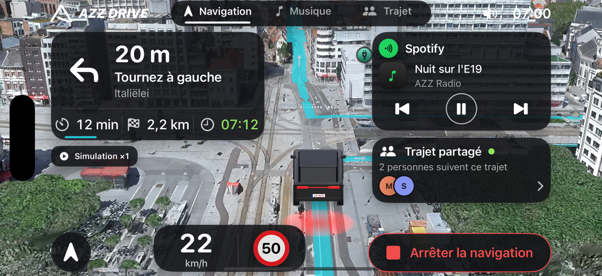
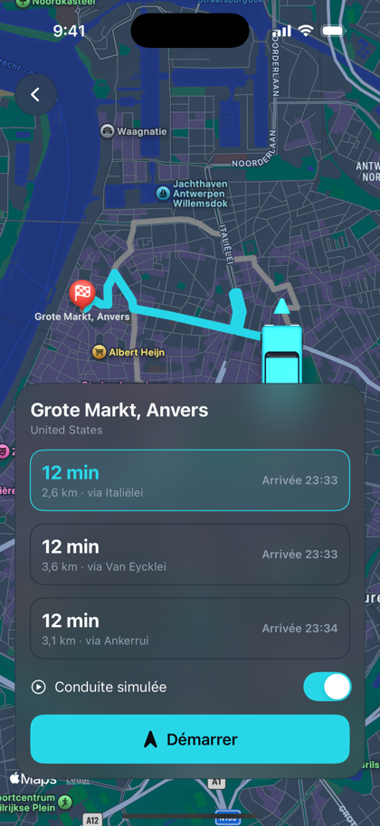
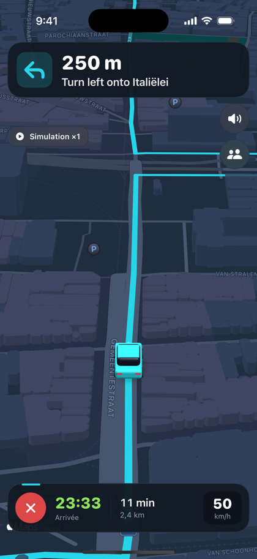
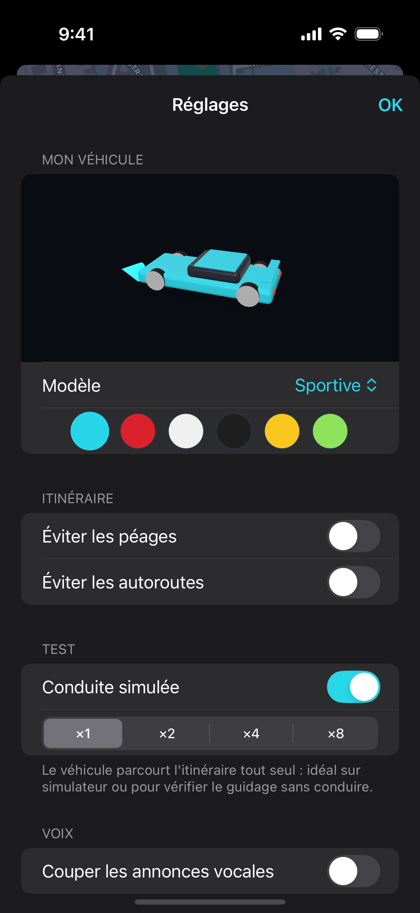
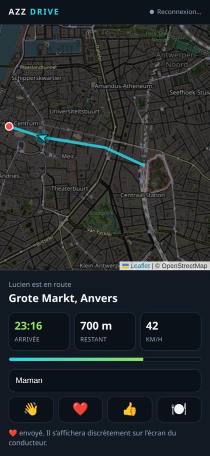
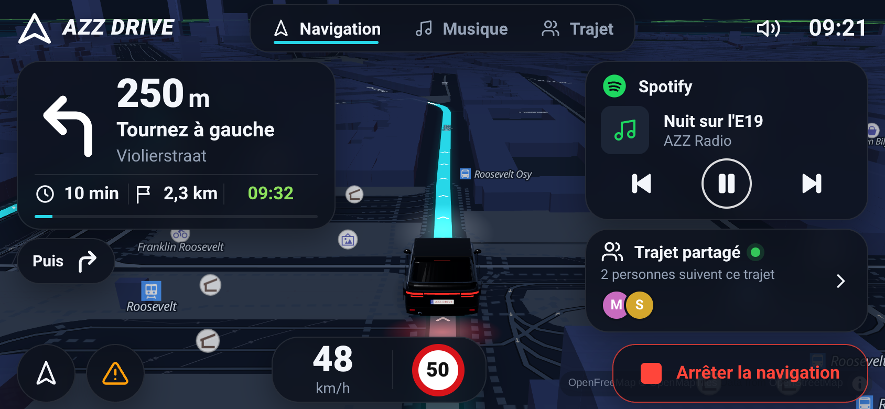
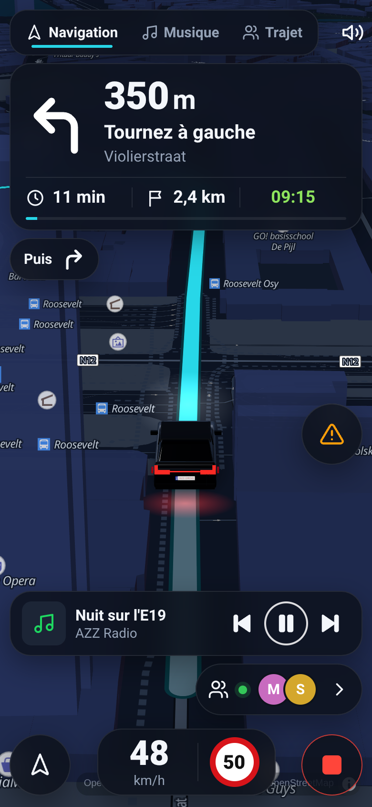
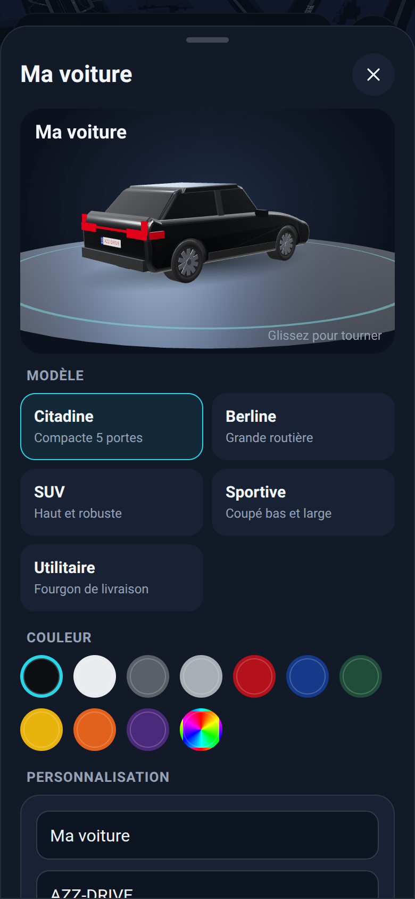
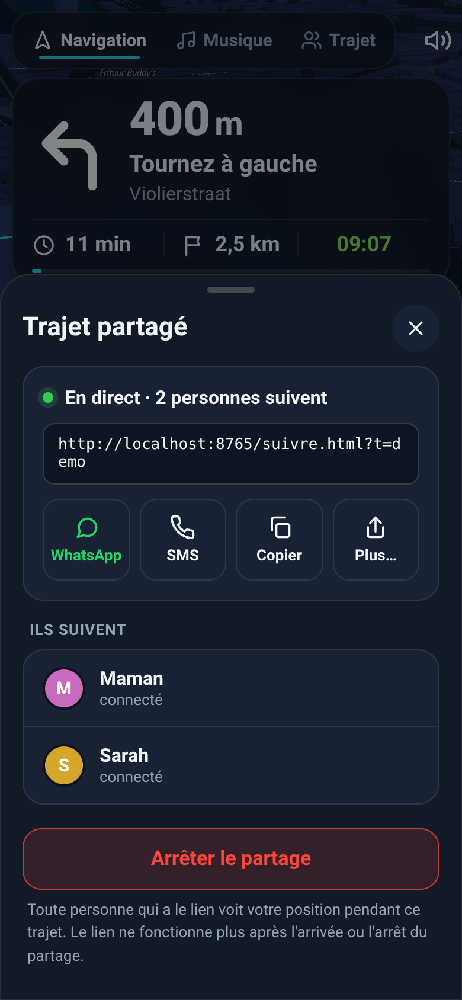
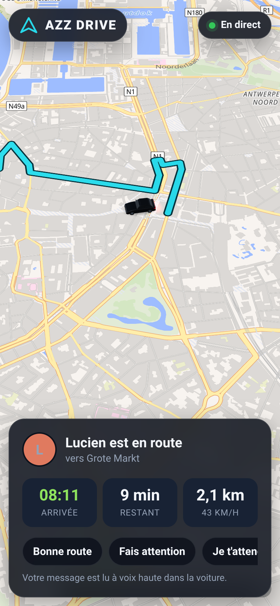

# AZZ DRIVE

Application iPhone de navigation (SwiftUI, iOS 17+) : carte 3D Apple Plans, véhicule 3D qui suit la route, guidage vocal en français, commandes Spotify intégrées et suivi du trajet en direct par les proches.

> Prototype. Respectez toujours le code de la route et la signalisation. Ne manipulez pas le téléphone en conduisant.

<p>

</p>

<p>




</p>

Captures prises automatiquement sur simulateur iPhone par le workflow GitHub Actions (arguments de démo `-AZZDemo -AZZDemoHUD -AZZLandscape -AZZMapStyle satellite3D` : Spotify, partage et limitation simulés).

## Application web (iPhone, Android, Windows) : à utiliser tout de suite

Ouvrir : **https://spiecelucien-crypto.github.io/AZZ-DRIVE/**

<p>

</p>
<p>




</p>

Installation comme une vraie app :
- iPhone : ouvrir le lien dans **Safari**, bouton **Partager**, puis **Sur l'écran d'accueil**. L'icône AZZ DRIVE s'ouvre en plein écran.
- Windows / Android : Chrome ou Edge, menu, **Installer AZZ DRIVE**.

Fonctions :
- Recherche d'adresse (Photon), itinéraires alternatifs (Valhalla, secours OSRM), options éviter péages / autoroutes.
- Guidage vocal en français, flèches de manœuvre, « Puis », recalcul automatique hors itinéraire, arrivée.
- Vue de poursuite 3D derrière votre voiture (Three.js dans MapLibre), bâtiments 3D, styles Nuit / Jour / Satellite / Auto, portrait et paysage.
- Garage : plus de 100 vrais modèles de 25 marques (Peugeot, Renault, Citroën, Dacia, Volkswagen, BMW, Mercedes, Audi, Tesla, Toyota, Ford, Fiat, Mini, Kia, Hyundai, Škoda, Seat, Cupra, Opel, Nissan, Volvo, Land Rover, Porsche, Ferrari, Lamborghini), avec recherche. Chaque modèle reprend ses vraies dimensions et sa signature : phares, calandre, feux arrière (griffes, bandeau, verticaux…), jantes, toit noir, électrique sans échappement. Silhouettes génériques toujours disponibles, couleur libre, nom et plaque.
- Radars fixes : base OpenStreetMap embarquée (mise à jour chaque semaine par `.github/workflows/radars.yml`) complétée en direct autour de vous. Bip, annonce vocale (« Radar dans 400 mètres, limité à 70 »), carte avec compte à rebours fluide qui passe au rouge et pulse en cas d'excès, icône sur la carte, prise en compte du sens de contrôle, radars signalés par la communauté. Mode « zones de danger » pour la France.
- Limitations de vitesse (OpenStreetMap) avec alerte de dépassement ; vitesse affichée lissée à 60 images/s, qualité de rendu adaptative si l'appareil ralentit.
- Spotify : lecture en cours, pause, suivant, playlists, recherche.
- Prévenir ses proches : lien de suivi envoyé par WhatsApp / SMS / partage. Le proche voit la voiture en direct, l'heure d'arrivée, et peut envoyer un message lu à voix haute dans la voiture.
- Signalements communautaires (police, accident, danger, bouchon, travaux, radar).
- Mode simulation pour tester un trajet sans rouler, écran maintenu allumé, cache hors ligne de l'app et des tuiles.
- Géolocalisation précise : filtre de Kalman (position + vitesse), rejet des points aberrants, vitesse Doppler du GPS, boussole quand on est à l'arrêt, accrochage à la route, estimation de position dans les tunnels (jusqu'à 30 s) et badge « GPS imprécis / signal perdu ».
- Rendu 3D : voitures détaillées (carrosserie arrondie, feux LED, jantes multibranches, étriers, disques), tracé lumineux avec chevrons de direction et flèche de manœuvre peinte sur la route avant chaque virage.

Brancher Spotify (une fois) :
1. Créer une app sur https://developer.spotify.com/dashboard (API : Web API).
2. Redirect URI : `https://spiecelucien-crypto.github.io/AZZ-DRIVE/`
3. Copier le Client ID dans AZZ DRIVE, onglet Musique. Compte Premium requis pour piloter la lecture ; en mode développement, ajouter jusqu'à 5 utilisateurs dans le tableau de bord.

Limites : pas de trafic en temps réel ; la base radars OpenStreetMap peut être incomplète (la signalisation prime) ; sur iPhone, le GPS d'une app web ne fonctionne que l'écran allumé et l'app au premier plan ; le partage passe par des relais MQTT publics (le lien aléatoire fait office de clé, ne le diffusez qu'à vos proches).

Code : dossier `windows/` (HTML/CSS/JS sans compilation), déployé automatiquement par `.github/workflows/pages.yml`.

## Installer l'app iOS native sur iPhone (depuis Windows)

Chaque mise à jour de `main` publie un fichier `AZZ-DRIVE.ipa` dans la release **ios-latest** (onglet Releases du dépôt). Il n'est pas signé : on le signe avec son propre identifiant Apple.

1. Installer **Sideloadly** (https://sideloadly.io) et iTunes (version du site Apple) sur Windows.
2. Brancher l'iPhone en USB, faire glisser `AZZ-DRIVE.ipa` dans Sideloadly, entrer son identifiant Apple, **Start**.
3. Sur l'iPhone : Réglages > Général > VPN et gestion de l'appareil > faire confiance au profil. Activer le **mode développeur** si iOS le demande (Réglages > Confidentialité et sécurité).
4. Avec un identifiant Apple gratuit, l'app doit être re-signée tous les 7 jours (Sideloadly le refait en un clic). Avec un compte Apple Developer (99 $/an), la signature dure un an et TestFlight devient possible.

## CarPlay

L'app native contient un écran CarPlay complet (`Sources/CarPlay`) : carte 3D qui suit la voiture, recherche, lieux à proximité (carburant, recharge, parking…), aperçu des itinéraires, guidage virage par virage dans le bandeau CarPlay, temps et distance restants, alertes. Il partage la session de l'iPhone : un trajet lancé sur l'un apparaît sur l'autre. La musique se pilote avec l'app Spotify CarPlay, à côté.

Apple n'affiche une app de navigation dans CarPlay que si elle possède le droit **CarPlay Navigation** :
1. Compte Apple Developer payant, puis demande sur https://developer.apple.com/contact/carplay (catégorie Navigation).
2. Une fois accordé : ajouter le droit à l'identifiant `com.azzdrive.app`, puis mettre `CARPLAY_ENTITLEMENTS = Config/CarPlay.entitlements` dans `Config/Secrets.xcconfig` et relancer `xcodegen generate`.
3. Test sans voiture : Xcode > Simulator > I/O > External Displays > CarPlay.

Sans ce droit (identifiant Apple gratuit, Sideloadly), tout le reste de l'app fonctionne, mais l'icône n'apparaît pas dans CarPlay. Une app web ne peut pas s'afficher dans CarPlay.

## Ce qui fonctionne (app iOS native)

| Fonction | État |
|---|---|
| Recherche d'adresse et de lieu | Apple Plans, 6 résultats proches de vous |
| Aperçu des itinéraires | Jusqu'à 3 trajets, durée, distance, heure d'arrivée, péages et autoroutes évitables |
| **Démarrage de la navigation** | Bouton « Démarrer » → guidage actif dans l'app (plus de renvoi vers Plans) |
| Suivi GPS | Accrochage à la route, filtrage du bruit, GPS en arrière-plan |
| Guidage | Prochaine manœuvre, distance, annonces vocales adaptées à la vitesse (par exemple 1 km / 300 m / maintenant) |
| Sortie de route | Détectée après 3 positions hors trajet, recalcul automatique |
| Arrivée | Détectée, annoncée, le partage passe à « arrivé » |
| Conduite simulée | Le véhicule parcourt le trajet tout seul (×1 à ×8) : test sur simulateur ou au bureau |
| Véhicule 3D | 5 modèles, 6 couleurs, roues qui tournent, cap lissé dans les virages |
| Caméra de navigation | Vue de poursuite derrière le véhicule (inclinaison max. Apple Plans) ou vue d'ensemble, zoom selon la vitesse |
| Écran de conduite | Mode paysage façon écran de voiture : onglets Navigation / Musique / Trajet, carte de manœuvre, vitesse, Spotify, trajet partagé |
| Styles de carte | Nuit, Jour, Satellite 3D (relief et bâtiments réalistes) |
| Limitations de vitesse | Panneau issu d'OpenStreetMap (indicatif), vitesse en rouge si dépassement |
| Proches qui suivent | Nombre et initiales des personnes qui regardent le trajet en direct |
| Spotify | Lecture/pause, suivant/précédent, playlists, recherche rapide, sans quitter la carte |
| Suivi par les proches | Lien à partager, page web en direct, heure d'arrivée, réactions |
| Tests | 17 tests du moteur (Linux et iOS) + 4 tests Spotify et partage (iOS) |

## Architecture

L'idée principale : **un seul moteur de navigation, sans interface, que tout le reste écoute.** La carte, le véhicule 3D, la voix, Spotify et le partage ne se parlent pas entre eux.

```
                    ┌──────────────────────────┐
  GPS réel ───────▶ │                          │ ──▶ LiveGuidance ──▶ bandeau, barre d'arrivée
                    │   NavigationSession      │ ──▶ SpeechService ──▶ annonces (baisse la musique)
  Simulation ─────▶ │  (chef d'orchestre)      │ ──▶ TripShareService ──▶ Firebase ──▶ page web des proches
                    │     └ NavigationEngine   │
                    │       (moteur pur, testé)│ ──▶ PoseInterpolator ──▶ boucle 60 i/s ──▶ caméra + véhicule 3D
                    └──────────────────────────┘
  SpotifyController ── indépendant ── API Web Spotify (lecture sur le téléphone)
```

### Dossiers

| Dossier | Rôle | Dépendances |
|---|---|---|
| `Sources/Core` | Géométrie, tracé, moteur de guidage, lissage du mouvement, caméra, simulation, modèle de partage | Foundation uniquement → testable partout |
| `Sources/Services` | GPS (CoreLocation), itinéraires (MapKit), voix (AVFoundation) | Frameworks Apple |
| `Sources/App` | Assemblage, réglages, `NavigationSession` | — |
| `Sources/Map` | Carte `MKMapView` pilotée image par image | MapKit |
| `Sources/Vehicle` | Modèles 3D et vue SceneKit transparente | SceneKit |
| `Sources/Spotify` | Connexion PKCE, trousseau, API, contrôleur | AuthenticationServices |
| `Sources/Sharing` | Publication du trajet (Firebase REST) | — |
| `Sources/UI` | Écrans SwiftUI | SwiftUI |
| `windows/` | Démo web + `suivi.html` (page des proches), publiées sur GitHub Pages | — |
| `firebase/` | Règles de sécurité de la base | — |

### Pourquoi c'est fluide

1. **Seul le véhicule est en 3D.** La carte 3D est celle d'Apple (déjà optimisée). Le véhicule est une petite vue SceneKit transparente de 132 × 132 points posée au-dessus, avec quelques centaines de triangles, sans ombre calculée.
2. **Une seule boucle d'image** (`CADisplayLink`) règle la caméra et place le véhicule au même instant : aucun décalage entre la route et la voiture. 60 images/s en conduite, 30 en exploration.
3. **Prédiction entre deux positions GPS.** Le GPS donne environ 1 position par seconde. Entre deux, le véhicule avance le long du tracé à la vitesse mesurée, puis l'écart est lissé (`PoseInterpolator`).
4. **SwiftUI ne redessine presque rien.** Les données qui changent souvent sont isolées dans `LiveGuidance`. Seuls le bandeau et la barre du bas se mettent à jour, pas la carte.
5. **Réseau économe.** Spotify interroge l'API toutes les 5 s, et seulement quand l'app est au premier plan. Le partage envoie environ 300 octets toutes les 5 à 15 s. Une seule requête à la fois : si le réseau rame, on saute une mise à jour.

## Démarrer

### Compiler sur Mac

```bash
brew install xcodegen
xcodegen generate
open AZZ-DRIVE.xcodeproj
```

Choisissez votre équipe de signature, puis lancez sur un simulateur iPhone. La **conduite simulée est activée par défaut sur simulateur** : cherchez une adresse, touchez « Démarrer », et la voiture roule toute seule.

Sur simulateur, définissez une position dans *Features > Location* (par exemple *Custom Location*), sinon l'itinéraire ne peut pas être calculé.

### Sans Mac (Windows)

- Le cœur de navigation se teste partout où Swift est installé : `swift test`.
- Chaque push et chaque pull request lancent automatiquement la compilation iOS et tous les tests sur un Mac GitHub (onglet **Actions**).

### Activer Spotify (5 minutes)

1. Sur [developer.spotify.com/dashboard](https://developer.spotify.com/dashboard), créez une app (API : *Web API*).
2. Redirect URI : `azzdrive-spotify://callback`. Bundle ID iOS : `com.azzdrive.app`.
3. Dans *User Management*, ajoutez le compte Spotify qui utilisera l'app. En mode développement, Spotify limite l'accès à 5 comptes autorisés et le propriétaire de l'app doit avoir Premium.
4. Copiez `Config/Secrets.example.xcconfig` en `Config/Secrets.xcconfig`, collez le Client ID, puis relancez `xcodegen generate`.
5. Dans l'app : Réglages > Spotify > Connecter.

Le contrôle de la lecture passe par l'API Web Spotify : la musique sort de l'app Spotify du téléphone. Si rien ne se passe, ouvrez Spotify une fois pour que le téléphone soit reconnu comme appareil de lecture.

### Activer le suivi par les proches (10 minutes, gratuit)

1. Créez un projet sur [console.firebase.google.com](https://console.firebase.google.com).
2. *Authentication > Sign-in method* : activez **Anonyme**.
3. *Realtime Database* : créez une base (région Europe), puis collez le contenu de `firebase/database.rules.json` dans l'onglet *Règles* et publiez.
4. Dans `Config/Secrets.xcconfig`, renseignez `FIREBASE_DATABASE_HOST` (par exemple `azz-drive-default-rtdb.europe-west1.firebasedatabase.app`, sans `https://`) et `FIREBASE_API_KEY` (paramètres du projet > Général > clé d'API Web).
5. Pendant la navigation, touchez le bouton « personnes » : la feuille de partage envoie le lien par Messages, WhatsApp, etc.

Ce que voient les proches : la voiture qui avance sur la carte, l'heure d'arrivée, la distance restante, la progression. Ils peuvent envoyer 👋 ❤️ 👍 🍽️ : la réaction s'affiche discrètement chez le conducteur. Le partage s'arrête tout seul à l'arrivée, et les liens expirent après 12 heures.

La clé d'API Firebase n'est pas un secret : elle identifie le projet. La protection vient des règles de sécurité (seul le conducteur modifie son trajet, lecture uniquement avec le lien, expiration automatique).

## Plan d'action

### Étape 1 — Démarrage d'itinéraire (fait dans cette version)
- [x] Départ depuis la vraie position GPS (et non plus le centre de la carte).
- [x] Aperçu des trajets puis bouton « Démarrer » : la navigation reste dans l'app.
- [x] Moteur de guidage testé : accrochage à la route, manœuvres, annonces, sortie de route, arrivée.
- [x] Recalcul automatique, GPS en arrière-plan, écran maintenu allumé.
- [x] Conduite simulée pour tester sans rouler.
- [ ] **À faire par vous :** un essai réel en voiture (passager) pour régler les seuils d'annonce.

### Étape 2 — Scène 3D du véhicule (fait)
- [x] Véhicule 3D léger, 5 modèles, 6 couleurs, aperçu tournant dans les réglages.
- [x] Mouvement fluide entre deux positions, cap lissé, roues animées.
- [x] Caméra de navigation : inclinaison 60°, zoom selon la vitesse, recentrage.
- [ ] Option : remplacer un modèle par un fichier `.usdz` détaillé (déposez par exemple `suv.usdz` dans un dossier `Sources/Vehicle/Models`, relancez `xcodegen generate` : il remplace automatiquement le modèle en code). Restez sous 20 000 triangles.

### Étape 3 — Spotify (fait, à configurer)
- [x] Connexion sécurisée PKCE, jeton dans le trousseau, rafraîchissement automatique.
- [x] Mini-lecteur sur l'écran de conduite, playlists et recherche en demi-feuille.
- [x] Réveil automatique du téléphone comme appareil de lecture.
- [ ] Option plus tard : SDK iOS Spotify (App Remote) pour un contrôle hors ligne. Plus rapide, mais SDK lourd à intégrer.

### Étape 4 — Suivi par les proches (fait, à configurer)
- [x] Lien de suivi, page web en direct, heure d'arrivée, réactions.
- [x] Publication économe et arrêt automatique.
- [ ] Option : Live Activity (écran verrouillé et Dynamic Island) pour le conducteur.

### Étape 5 — Ensuite
- Signalements communautaires (accident, danger, police), stockés dans la même base Firebase.
- CarPlay : fait (voir la section CarPlay), en attente du droit Apple.
- Commandes vocales (« emmène-moi à… ») avec `Speech`.
- Favoris et destinations récentes.

## Limites connues

- Les itinéraires viennent d'Apple Plans : trafic Apple, pas de trafic communautaire type Waze.
- Le guidage n'a pas encore été validé en conditions réelles.
- Apple Plans limite l'inclinaison de la caméra : la vue de poursuite est plongeante, pas au ras de la rue. Une vraie vidéo de rue n'est pas disponible en direct.
- Les limitations OpenStreetMap peuvent manquer ou être anciennes : elles sont indicatives, la signalisation prime.
- Spotify en mode développement : 5 comptes maximum, Premium obligatoire pour le propriétaire de l'app.
- En France, signaler la position exacte des radars est interdit : activer « Mode zones de danger » dans les réglages.
